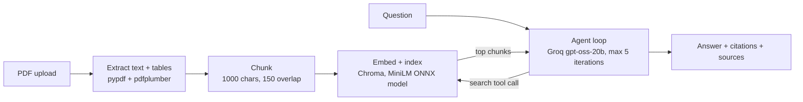
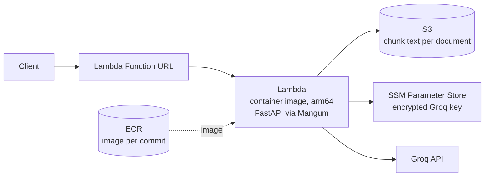
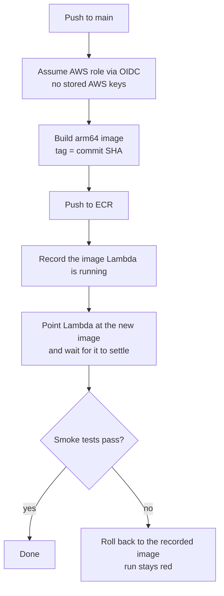

# Financial Document Agent

Upload a financial PDF (10-K, earnings release, quarterly statement) and ask questions in plain English. The agent searches the document, answers from what it finds, and cites the exact source chunks.

**Try it:** [live Streamlit demo](https://YOUR-STREAMLIT-APP.streamlit.app) · also deployed as a serverless API on AWS with a CI/CD pipeline (see [Deployment](#deployment-on-aws) below).

## What it does

- Extracts text and tables from an uploaded PDF
- Splits it into overlapping chunks and indexes them for semantic search
- Runs a small tool-calling agent: the model decides *when and how often* to search the document, then writes a grounded answer with `[chunk_N]` citations
- Returns the answer plus the list of chunks the agent actually retrieved

## How it works



Key design choices:

- **Agentic RAG, not fixed top-k.** Retrieval is a tool the model chooses to call, so a question that needs two lookups can make two.
- **Sources are tracked server-side.** The API returns the chunks that were really retrieved, not whatever citation text the model wrote. Models occasionally format citations inconsistently (for example `【chunk_2】` instead of `[chunk_2]`), so the code does not depend on parsing them.
- **Framework-free core.** The pipeline is plain Python so the mechanics stay visible. `core/` is shared by both front ends.

## Architecture

Two independent deployments share the same `core/` logic:

| Path | Hosting | Purpose |
|---|---|---|
| `streamlit_app.py` | Streamlit Community Cloud | Public demo UI, calls `core/` in-process |
| `api/` (FastAPI + Mangum) | AWS Lambda behind a Function URL | The deployed backend, built and shipped by CI/CD |

## Deployment on AWS



| Concern | Choice | Why |
|---|---|---|
| Compute | Lambda container image (arm64) | Pay per request; the dependencies are too large for a zip package |
| State | S3, cache-aside | Lambda has no durable memory between requests, so chunk text is stored in S3 and the vector index is rebuilt on a cold start |
| Secrets | SSM Parameter Store (SecureString) | Free at Standard tier, encrypted, readable only by the function's role |
| Embedding model | Baked into the image at build time | Lambda's filesystem is read-only outside `/tmp`, so the model can't be downloaded at runtime |
| Front door | Function URL | No 30-second API Gateway cap |

## CI/CD

Every push to `main` builds, deploys and verifies the API automatically (GitHub Actions).



- **No long-lived credentials.** GitHub issues a short-lived signed token; AWS trusts it through an IAM OIDC provider. The deploy role's trust policy is pinned to this exact repository and branch using GitHub's immutable repo and owner IDs, and its permissions cover only this ECR repository and this Lambda function.
- **Traceable deploys.** Images are tagged with the commit SHA, so any live image maps back to one commit.
- **Smoke tests that exercise real dependencies.** After each deploy the pipeline checks that the app routes, uploads a small synthetic PDF end to end (parsing, chunking, embedding model, S3 write, `chunk_count > 0`), and confirms the S3 read path returns the app's own 404 for an unknown document. None of these call the LLM, so they cost nothing and don't depend on Groq's availability.
- **Automatic rollback.** If a check fails after the switch, the pipeline re-points Lambda to the previous image and leaves the run red. This was verified by deliberately shipping a broken commit and confirming the same image digest was restored.
- **Cost control.** An ECR lifecycle policy keeps the newest 5 images (each is about 4 GB) and a budget alert is configured on the account.

## Run it locally

```bash
python -m venv .venv && source .venv/bin/activate
pip install -r requirements.txt
echo "GROQ_API_KEY=your_key" > .env

streamlit run streamlit_app.py            # demo UI
uvicorn api.main:app --reload             # REST API, docs at /docs
```

API usage (replace the host with your own deployment):

```bash
# 1. upload a PDF -> returns {"document_id": "...", "chunk_count": N}
curl -F "file=@statement.pdf;type=application/pdf" https://<your-api-host>/documents

# 2. ask a question about it
curl -X POST https://<your-api-host>/documents/<document_id>/ask \
  -H "Content-Type: application/json" \
  -d '{"question": "What was revenue in the latest quarter?"}'
```

## Known limitations and what I'd do next

| Limitation | Planned fix |
|---|---|
| The deployed endpoint is public with no authentication | Add an API-key check backed by Parameter Store (and per-user auth if it ever serves real users) |
| No unit tests, only the post-deploy smoke tests | Add pytest coverage for extraction, chunking and retrieval, run before the image is built |
| Smoke tests skip the LLM path, so a bad Groq key would still pass | A scheduled or manual workflow that asks one real question |
| A broken image is briefly live (about 2 to 3 minutes) before rollback finishes | Publish a Lambda version and shift an alias only after the tests pass |
| Fixed-size character chunking can split a number or word across chunks | Sentence- or table-aware chunking |
| Extraction combines two PDF libraries, so some text is duplicated | Deduplicate before chunking |
| Cold starts are slow because the image is about 4 GB | Slimmer dependencies, or provisioned concurrency if latency ever matters |
| Answers can mislabel the reporting period on vague questions | Stricter period grounding in the system prompt, plus an evaluation set |

## Repository layout

```
core/            extraction, chunking, retrieval, agent loop
api/             FastAPI app, S3 document store, Lambda handler
streamlit_app.py demo UI
Dockerfile       Lambda container image
tests/fixtures/  tiny synthetic PDF used by the smoke test
.github/workflows/deploy.yml   build, deploy, verify, roll back
```
